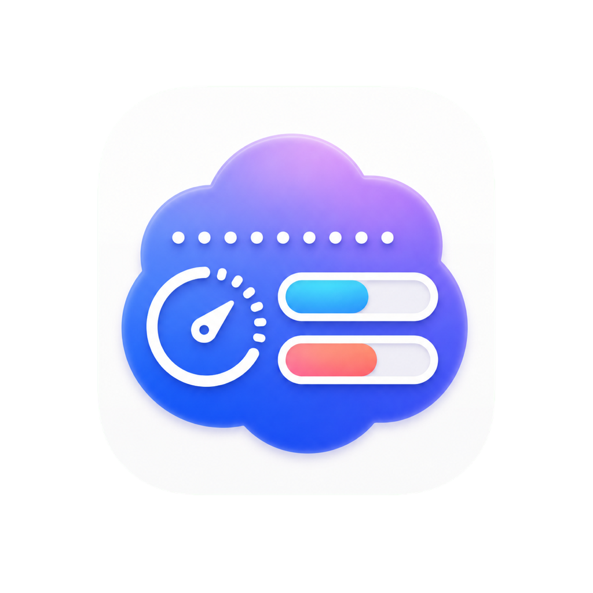
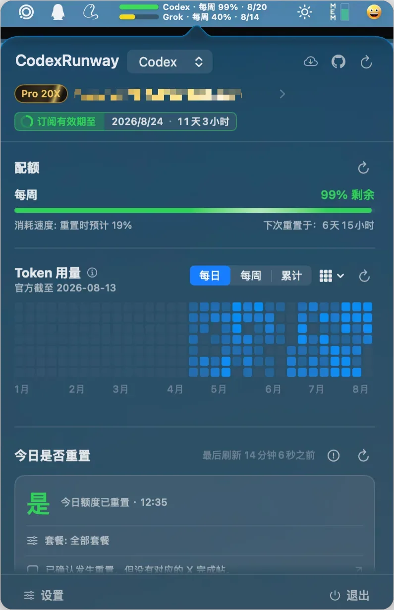
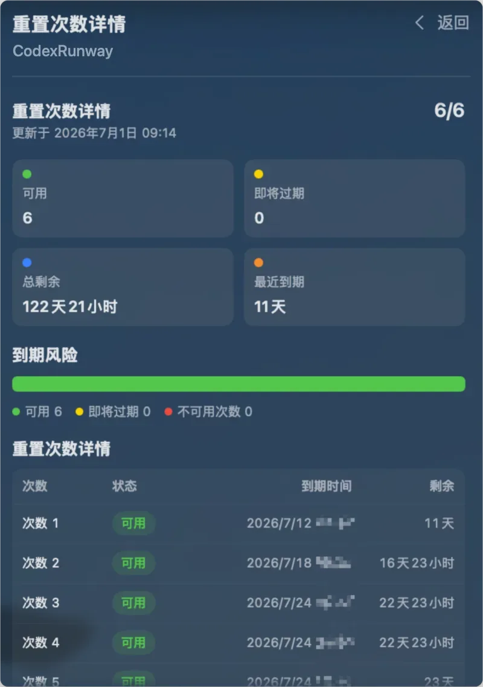
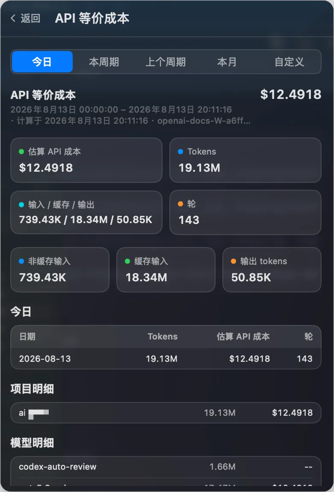
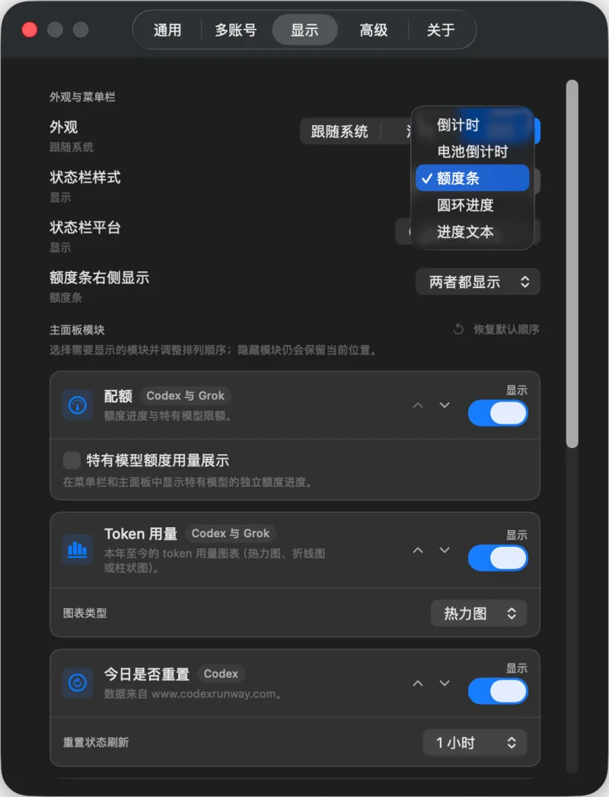
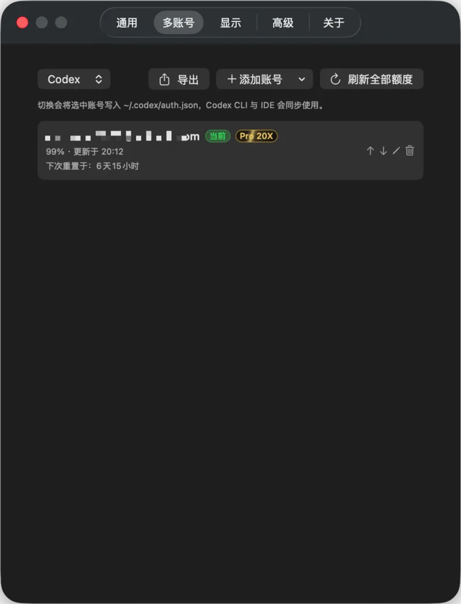

[English](./README.md) · [简体中文](./README_ZH.md) · 繁體中文 · [한국어](./README_KO.md) · [日本語](./README_JA.md) · [Русский](./README_RU.md) · [Français](./README_FR.md)

<p align="center">
  
</p>

# CodexRunway

你的 Codex 還可以跑多久？

CodexRunway 是一個原生 macOS 選單列應用程式，幫你在選單列查看 Codex 額度，並提供 Codex 的今日是否重設、reset credits、API 等價成本與本機工作階段能力，以及 Codex 的多帳號管理。

## 亮點

- 選單列查看 Codex 剩餘額度。
- 查看 5 小時、每週和附加額度視窗。
- 查看今日速率限制是否已重設（資料來自 [www.codexrunway.com](https://www.codexrunway.com)），並可跳轉到相關公開動態。
- 設定中可開關「今日是否重設」欄目，並單獨設定其重新整理間隔（預設開啟、每 5 分鐘）。
- 管理多個 Codex 帳號：瀏覽器登入、匯入本機 `auth.json`、貼上 token / JSON（含 `/auth/session`）、匯入檔案或 API Key。
- 確認後安全切號，原子寫回 `~/.codex/auth.json`，可選立即重新啟動 Codex，使 CLI / IDE 同步。
- 顯示目前帳號、訂閱類型與到期資訊。
- 用官方週占用率和每日 Credits 推算本週額度，並與歷史推算比較，方便發現是否被下調；設定中可開關，預設開啟。
- 查看 reset credits 數量、狀態和到期時間。
- 查看 API 等價成本與 token 用量：今日、本週期、上週期、本月或自訂範圍；設定可改主彈窗預設範圍。
- 主彈窗配額下方顯示本年 token 用量圖表（熱力圖 / 折線圖 / 長條圖，每日 / 每週 / 累計），設定中可切換樣式或關閉；預設熱力圖。
- 本機工作階段增量索引，加速成本掃描。
- 查看最近 Codex 工作階段、專案、狀態和用量摘要。
- 修復本機工作階段索引。
- 支援淺色、深色、跟隨系統，以及 English、简体中文、繁體中文、한국어、日本語、Русский、Français 介面。
- 提供 macOS 14+ 桌面小工具：額度總覽、Token 趨勢、關鍵指標和今日重設。

## 截圖

<p align="center">
  
  
  
  
  
</p>

## 安裝

### 手動安裝

用 `Scripts/package-app.sh` 在本機構建 DMG，開啟與你的 Mac 相符的安裝檔：

- Apple Silicon：`CodexRunway-macos-arm64.dmg`
- Intel：`CodexRunway-macos-x86_64.dmg`

開啟 DMG 後把 `CodexRunway.app` 拖入 `Applications`，也可以手動解壓同架構的 ZIP。

### macOS 安全阻擋

目前 Release 是 ad-hoc signed，未 notarized。首次開啟如果提示「無法驗證開發者」或「未經安全驗證」，請按住 Control 點按 `CodexRunway.app`，選擇「打開」，或在「系統設定 > 隱私權與安全性」中點選「仍要打開」。

如果提示「CodexRunway.app 已損壞，無法打開。你應該將它移到垃圾桶」，通常是下載隔離屬性導致的。把 app 放入 `Applications` 後執行：

```bash
xattr -dr com.apple.quarantine /Applications/CodexRunway.app
```

然後再次開啟應用程式。

## 使用前提

- macOS 12+
- 建議已安裝並使用過 Codex
- 可透過本機 `~/.codex/auth.json` 匯入，或在應用程式內新增帳號（瀏覽器登入、貼上憑證、匯入檔案等）

## 本機執行

```bash
swift run CodexRunway
```

在 macOS 14+，該命令會自動建置並註冊獨立的 `CodexRunway Dev` 應用程式和 Widget 延伸功能，然後啟動它；開發應用程式位於 `.build/codex-runway-widget-dev/CodexRunway-dev.app`，可直接從系統小工具庫新增。啟動前請先結束其他正在執行的 CodexRunway 實例。若只需執行未打包的命令列行程，可設定 `CODEX_RUNWAY_DISABLE_DEV_APP=1`。

自檢命令：

```bash
swift run CodexRunway --self-check
```

自檢只讀取本機狀態，不請求網路；它會輸出脫敏的 Codex 診斷、憑證狀態和帳號身分。任何 token 或 API Key 都不會列印。

## 桌面小工具

桌面小工具要求 macOS 14+。從包含此修復的版本起，正式 Release 和本機開發建置都會包含 Widget 延伸功能。小工具展示 Codex 資料。升級後，macOS 會從應用程式套件的 `Contents/PlugIns` 註冊正式版小工具。

`swift run CodexRunway` 使用獨立的 `swift-dev` 識別碼，不會覆蓋現有安裝。也可使用 `.dev` 識別碼手動產生帶小工具的應用程式：

```bash
INCLUDE_WIDGET=1 \
RUNWAY_BUNDLE_ID=com.github.codex-runway.dev \
RUNWAY_APP_GROUP_ID=group.com.github.codex-runway.dev \
RUNWAY_WIDGET_STORAGE_MODE=local \
bash Scripts/package-app.sh
```

產生的應用程式位於 `dist/CodexRunway.app`。包含此修復的正式 Release 和本機 ad-hoc 建置預設從 `~/.codex-runway/widget-snapshot.json` 讀取權限為 `0600` 的版本化衍生快照；已註冊 App Group 的 Developer ID 建置可改用 `RUNWAY_WIDGET_STORAGE_MODE=app-group`。快照不含信箱、帳號 ID、token、認證 JSON 或外部事件原文。後續仍可接入 Developer ID、App Group 註冊與公證。

## 網路代理

在 **控制面板 → 一般 → 網路** 中選擇 **跟隨系統**、**HTTP 代理** 或 **SOCKS5 代理**，自訂代理支援使用者名稱與密碼驗證；設定涵蓋 Codex 請求，以及公開狀態與價格來源；瀏覽器登入頁面與已執行的外部 CLI 程序沿用各自的網路設定，不修改系統代理

修改須點擊 **儲存代理設定** 後生效；**測試連線** 用目前草稿檢查網路連通性，不傳送帳號憑據，也不儲存草稿；代理憑據儲存在 macOS 鑰匙圈，與非機密設定分開存放；設定損壞、憑據無法使用或自訂代理失敗時不會自動直接連線，請修復設定或主動改回 **跟隨系統**

## 隱私

- token 從本機 `~/.codex/auth.json` 讀取；多帳號憑證僅保存在 `~/.codex-runway/accounts/<id>/auth.json`（目錄 `0700`、檔案 `0600`）。帳號索引 `index.json` 不含 token。
- 使用者主動切號時，才會將選中憑證原子寫回 `~/.codex/auth.json`，以便 Codex CLI / IDE 同步使用。
- 重新整理非目前託管帳號 token 時只更新帳號庫副本，不寫官方 `auth.json`；重新整理目前帳號時同步官方 auth 與副本。
- 無效或 mock 憑證不會寫回官方 `~/.codex/auth.json`。
- access token、refresh token、id token、API key 不會寫入日誌、README、issue 範本或自檢輸出。
- API 等價成本預設來自本機工作階段 JSONL 日誌，並在 `~/.codex-runway/` 下維護本機增量索引等衍生資料；不上傳工作階段內容。
- 訂閱額度推算只把衍生的 Credits 合計與占用率寫入 `~/.codex-runway/quota-estimate-history.json`，不含 token 或金鑰。
- API 等價成本的線上用量只在本機沒有可用 token 資料時作為補全。Token 圖表的「官方統計（多端）」來自目前帳號的官方資料統計，可能延遲或後續修訂；「本機日誌（全部本機工作階段）」掃描本機現有工作階段，歷史記錄可能跨帳號。每日數據使用 UTC 日期，以便兩邊使用同一日界。兩者口徑不同，不能視為包含關係或直接相減。
- 工作階段修復只處理 `~/.codex/session_index.jsonl`，寫入前會建立備份，不刪除工作階段檔案。
- 「今日是否重設」只下載公開狀態源，不附帶 Codex 帳號、token 或本機工作階段內容。
- 桌面小工具快照儲存僅保存額度、餘額、衍生成本、Token 日序列和重設狀態等非金鑰資料；主應用程式是唯一寫入者，小工具唯讀。

## 資料來源

- **今日是否重設**：資料來自 [https://www.codexrunway.com/api/status.json](https://www.codexrunway.com/api/status.json)，非官方且僅供參考，可能延遲或暫時無法使用。
- **配額 / reset credits / 訂閱額度推算 / Token 用量官方統計 / 部分線上用量**：在你已登入的前提下，透過本機憑證存取官方 ChatGPT / Codex 後端介面；官方 Token 統計僅對應目前帳號，並顯示伺服端統計截至日期。訂閱額度推算非正式：用週占用率和每日 Credits 外推本週額度（1000 Credits ≈ $40，版本 `credits-usd-2026-08-26`）。
- **Token 用量本機日誌 / API 等價成本 / 最近工作階段**：預設基於本機 `~/.codex` 工作階段日誌與本機索引計算。本機歷史日誌沒有可靠的帳號歸屬，因此可能包含多個帳號的資料。

## 開發與貢獻

```bash
swift test
swift build
swift build -c release
```

貢獻說明見 [CONTRIBUTORS.md](CONTRIBUTORS.md)。

## 社群支援

- [LinuxDO](https://linux.do/)

## 授權條款

本專案遵循倉庫中的 [LICENSE](LICENSE)。
